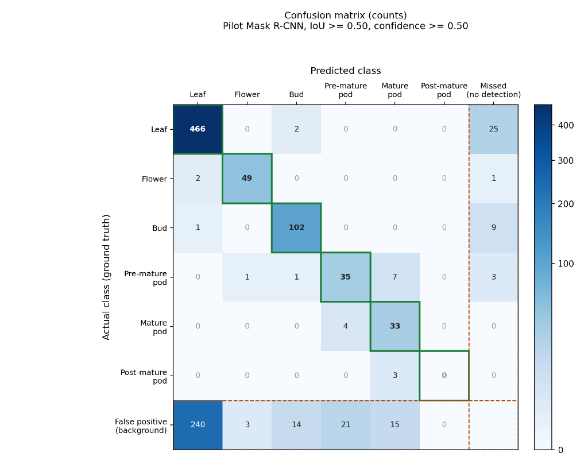
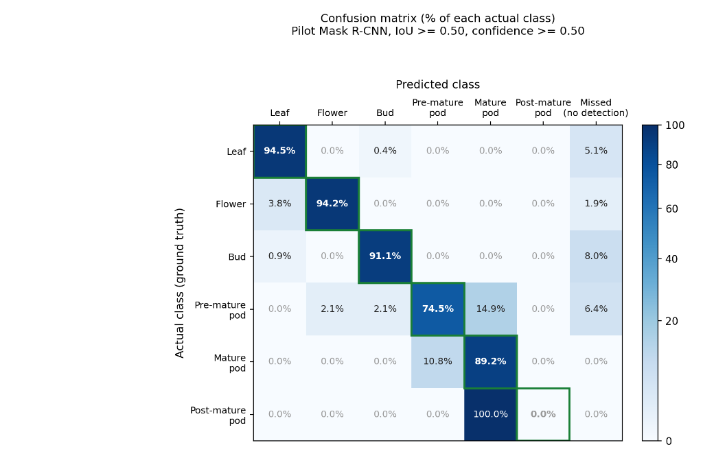

# Pilot Model Training - Canopy Instance Segmentation

This directory contains the complete pipeline, architecture, and evaluation benchmarks for the **Mask R-CNN Instance Segmentation Pilot Model** used in the IoT Canopy Phenotyping Project.

---

## 1. Overview & Architecture

The model performs instance segmentation to detect and delineate vegetative and reproductive plant parts (leaves, flowers, buds, and pods across three maturation stages).

* **Model Framework:** PyTorch & Torchvision
* **Architecture:** Mask R-CNN (`maskrcnn_resnet50_fpn`)
* **Backbone:** ResNet-50 with Feature Pyramid Network (FPN) pre-trained on MS COCO
* **Custom Prediction Heads:**
  * `FastRCNNPredictor`: 7 target output classes (background + 6 canopy instance classes)
  * `MaskRCNNPredictor`: 256 hidden channels with transposed convolutions generating binary instance masks
* **Input Image Dimension:** $1024 \times 768 \times 3$ (HSIE-Enhanced RGB)

### Target Classes (7)
0. `__background__`
1. `leaf`
2. `flower`
3. `bud`
4. `pre_mature_pod`
5. `mature_pod`
6. `post_mature_pod`

---

## 2. Model Performance & Evaluation

The pilot model was evaluated on all 168 multi-week dataset images on an NVIDIA GPU using standard criteria ($IoU \ge 0.50$, $\text{Confidence} \ge 0.50$).

### Key Performance Summary
* **Flower:** Recall = **94.2%** | Precision = **94.2%**
* **Bud:** Recall = **91.1%** | Precision = **87.9%**
* **Mature Pod:** Recall = **89.2%** | Precision = **68.8%**
* **Leaf:** Recall = **94.5%** | Precision = **66.0%** (240 false alarms due to unannotated background canopy foliage)
* **Pre-mature Pod:** Recall = **74.5%** | Precision = **62.5%**

---

## 3. Confusion Matrix

### Counts Confusion Matrix
The count matrix illustrates raw classification matches, misclassifications, missed targets (False Negatives), and background false alarms (False Positives):



### Normalized Confusion Matrix (%)
The normalized matrix shows the true positive recall rate and error distribution percentage for each actual class:



---

## 4. Pipeline Files

| File | Description |
| :--- | :--- |
| `model.py` | Model factory constructing the Mask R-CNN ResNet-50-FPN architecture with custom heads for 7 classes. |
| `dataset.py` | PyTorch `Dataset` loading CVAT XML annotations, scaling coordinates, and converting polygons to binary raster masks (`cv2.fillPoly`). |
| `train.py` | Complete training loop with 85/15 train-validation split, SGD optimization with StepLR scheduling, and best-checkpoint saving. |
| `evaluate_model.py` | Evaluation script calculating TP, FP, Recall, Precision, Confusion Matrix, and cross-class overlap rates on GPU. |
| `predict.py` | Inference script with **Cross-Class NMS** ($IoU \ge 0.35$) and adaptive thresholds to eliminate duplicate overlapping boxes. |
| `sample_dataset/` | Curated sample images across development days with matched CVAT XML annotations. |

---

## 5. Curated Sample Dataset (`sample_dataset/`)

A curated set of representative high-quality HSIE-enhanced images and matched CVAT XML annotations:

```text
sample_dataset/
├── sample_annotations.xml
└── dataset_processed/
    ├── day_02/hsie_enhanced/canopy_20260828_150037_hsie.png  (Early foliage)
    ├── day_05/hsie_enhanced/canopy_20260921_121828_hsie.png  (Flower, bud, pod & leaf)
    └── day_07/hsie_enhanced/
        ├── canopy_20260930_122535_hsie.png                  (Flower, bud & leaf)
        └── canopy_20260930_163948_hsie.png                  (Mature pods & buds)
```

---

## 6. How to Run

### A. Inference on a Test Image
```bash
python predict.py "sample_dataset/dataset_processed/day_05/hsie_enhanced/canopy_20260921_121828_hsie.png"
```
The output overlay with bounding boxes, segmentation masks, and confidence scores is saved to `pilot_prediction_result.png`.

### B. Evaluate the Model
```bash
python evaluate_model.py
```

### C. Train the Model
```bash
python train.py
```
Weights are saved as `canopy_maskrcnn.pth`.
